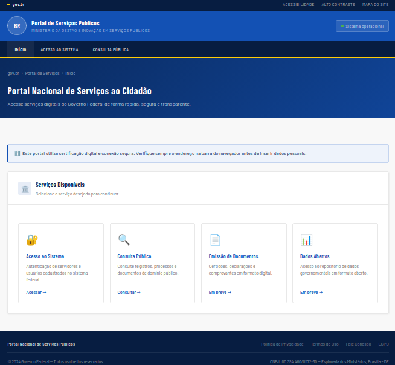
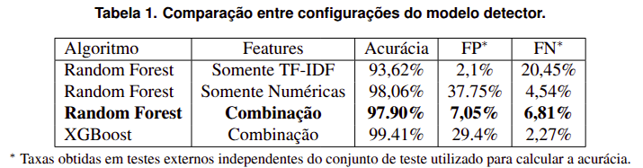
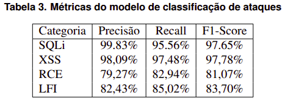
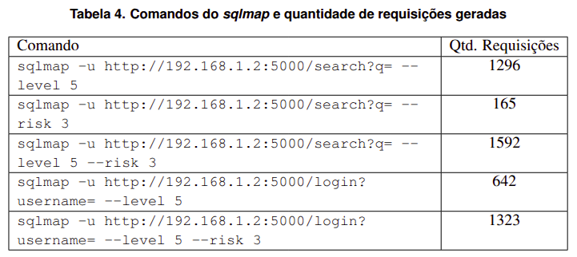
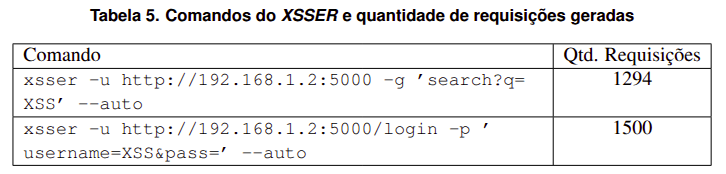
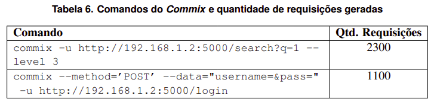
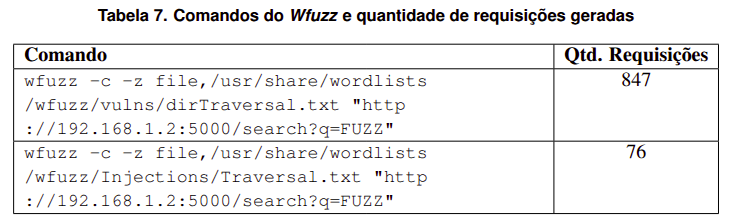

# WebTrap: Uma Ferramenta de Detecção de Ataques em Requisições HTTP Utilizando Aprendizado de Máquina

Repositório referente ao artigo completo submetido à Trilha Principal do 26º Simpósio Brasileiro de Cibersegurança (SBSEG26).

**Resumo:** Segundo o relatório OWASP Top 10 2025, vulnerabilidades do tipo Injection permanecem entre os principais riscos de segurança para aplicações web. Este trabalho propõe um honeypot web que integra dois modelos de aprendizado de máquina a mecanismos de *deception*. O primeiro modelo identifica requisições HTTP associadas aos ataques SQL Injection, Cross-Site Scripting, Remote Code Execution e Local File Inclusion, distinguindo-as do tráfego benigno, enquanto o segundo classifica a categoria do ataque detectado. Os resultados indicaram taxas de detecção superiores a 94% para tráfego malicioso gerado por ferramentas como sqlmap, XSSER, Commix e Wfuzz. Para requisições benignas, foi obtida uma taxa de acerto de aproximadamente 93%, evidenciando a viabilidade da abordagem proposta para honeypots web inteligentes.

---

# Repositórios

Os artefatos associados ao artigo estão divididos em dois repositórios diferentes, a fim de organização:

- [**webtrap-sbseg26**](https://github.com/pedro-hfw/webtrap-sbseg26): Honeypot web e treinamento de modelos de aprendizado de máquina.
- [**webtrap-dataset-creation-sbseg26**](https://github.com/pedro-hfw/webtrap-dataset-creation-sbseg26): Scripts de geração e coleta de requisições para compor o dataset final.

Este repositório corresponde ao primeiro link acima, abordando o WebTrap (honeypot web + ml + deception) e o treinamento dos modelos de aprendizado de máquina.


---


# Estrutura do README

Este README está organizado da seguinte forma:

1. [**Título e Resumo**](#webtrap-uma-ferramenta-de-detecção-de-ataques-em-requisições-http-utilizando-aprendizado-de-máquina)
1. [**Repositórios**](#repositórios)
1. [**Principais Funcionalidades**](#principais-funcionalidades) 
1. [**Arquitetura Geral**](#arquitetura-geral)
1. [**Selos Considerados**](#selos-considerados)
1. [**Dependências**](#dependências)
1. [**Preocupações com Segurança**](#preocupações-com-segurança)
1. [**Estrutura do Repositório**](#estrutura-do-repositório)
1. [**Armazenamento de Logs**](#armazenamento-de-logs)
1. [**Instalação**](#instalação)
1. [**Execução**](#execução)
1. [**Experimentos**](#experimentos)
1. [**Reivindicações**](#reivindicações)
1. [**Licença**](#licença)
---

# Principais Funcionalidades

- Honeypot Web desenvolvido em Flask

- Detecção automática de tráfego malicioso

- Classificação do tipo de ataque web (SQLi, XSS, RCE, LFI)

- Simulação dinâmica de vulnerabilidades baseada em Deception

- Registro detalhado das requisições em formato NDJSON

- Rastreamento de endereços IP

- Código completo para treinamento e teste dos modelos de aprendizado de máquina

---

# Arquitetura Geral

```text
                   Requisição HTTP
                          │
                          ▼
              Classificador de Tráfego 
               │                    │
            Benigno             Malicioso
               │                    ▼
        Resposta normal    Classificador de Ataques
               │                    │
               ▼                    ▼
        Registro em Logs   Mecanismo de Deception
                                    │
                                    ▼
                           Resposta falsa adaptativa
                                    │
                                    ▼
                           Registro em Logs
```


---


# Selos Considerados

Os autores julgam como considerados no processo de avaliação os selos:

- **Artefatos Disponíveis (SeloD)**

- **Artefatos Funcionais (SeloF)**

- **Artefatos Sustentáveis (SeloS)**

- **Experimentos Reprodutíveis (SeloR)**

Com base nos códigos e documentação disponibilizados neste e no [segundo repositório](#repositórios).


---


# Dependências

## Hardware

### WebTrap

- Linux (Ubuntu 22.04+, Debian 12+ ou equivalente)
- CPU: mínimo de 4 núcleos (recomendado: 8+)
- RAM: mínimo de 4 GB (recomendado: 8 GB+)
- Espaço em disco: mínimo de 10 GB
- Interface de rede

### Treinamento e Teste de Modelos de Aprendizado de Máquina

- Linux
- CPU: mínimo de 4 núcleos (recomendado: 8+)
- RAM: mínimo de 4 GB (recomendado: 8 GB+)
- Espaço em disco: mínimo de 10 GB

### Teste de Requisições Benignas e Ferramentas Automatizadas

- Linux
- CPU: mínimo de 4 núcleos (recomendado: 8+)
- RAM: mínimo de 4 GB (recomendado: 8 GB+)
- Espaço em disco: mínimo de 10 GB


## Software

- [Git](https://git-scm.com/install/) instalado
- [Python](https://www.python.org/downloads/) 3.12.3+ instalado
- pip
- venv

### Script de Instalação do Git

```bash
sudo apt update
sudo apt install git
```

### Script de Instalação do Python, pip e venv

```bash
sudo apt update
sudo apt install python3-full python3-venv
```

Outras dependências podem ser vistas no arquivo `requirements.txt`, a saber:

```text
# Framework Web
Flask==3.1.3
Werkzeug==3.1.8
Jinja2==3.1.6
MarkupSafe==3.0.3
itsdangerous==2.2.0
click==8.4.1
blinker==1.9.0
python-dotenv==1.2.2

# ML e Dados
scikit-learn==1.9.0
xgboost==3.2.0
numpy==2.4.6
pandas==3.0.3
scipy==1.17.1
joblib==1.5.3

# Teste Benigno
faker==40.36.0
requests==2.34.2

# Utilitários
narwhals==2.22.1
python-dateutil==2.9.0.post0
six==1.17.0
threadpoolctl==3.6.0
```

É possível instalá-las rapidamente como mostrado na seção [Instalação](#instalação).


---


# Preocupações com Segurança

## Porta utilizada

Por padrão o WebTrap executa em:

```
http://127.0.0.1:5000
```

O endereço IP e a porta de execução do WebTrap podem ser modificados por meio das flags `-e` e `-p`, de acordo com as instruções na seção de [Execução do WebTrap](#a-webtrap).

> ⚠️ Utilizar a flag `-e` altera o endereço IP para `0.0.0.0` e permite conexões externas dependendo da configuração da máquina e do firewall.

> ⚠️ Algumas portas podem exigir privilégios de administrador. 

## Chave secreta

O Flask utiliza uma chave secreta para assinar cookies de sessão.

Nunca compartilhe a `SECRET_KEY` utilizada em produção.


---


# Estrutura do Repositório

O repositório está dividido da seguinte forma:

```
webtrap-sbseg26/
├── app.py                                  # Servidor Flask do Webtrap
│
├── honeypot/               
│   ├── deception.py                        # Deception para cada tipo de ataque
│   ├── logger.py                           # Criação de logs das requisições e do IP Tracker
│   ├── templates/                          # Pasta com páginas HTML
│   ├── static/                             # Pasta com estilos CSS
│   └── logs/                               # Pasta contendo logs
|
├── ml/                     
│   ├── features.py                         # Extração de features em tempo de execução
│   ├── keywords.py                         # Palavras-chave usadas pelo "features.py"
│   ├── attack_model/                       # Pasta contendo o modelo de classificador de ataques
│   └── request_model/                      # Pasta contendo o modelo de detecção de requisições maliciosas
│
├── testing/               
│   └── test_benign.py                      # Teste de requisições benignas
|
└── training/                               # Pasta com artefatos usados no treinamento dos modelos de aprendizado de máquina
    ├── datasets/                           # Datasets CSV usados no treinamento
    ├── attack_keywords.py                  # Palavras-chave usadas pelos extratores de features
    ├── ml_features_extraction_attack.py    # Extração de features do modelo de classificação
    ├── ml_features_extraction_request.py   # Extração de features do modelo de detecção
    ├── train_attack_model.py               # Treinamento do modelo de classificação
    ├── test_attack_model.py                # Teste básico do modelo de classificação
    ├── train_request_model.py              # Treinamento do modelo de detecção
    ├── test_request_model.py               # Teste básico do modelo de detecção
    ├── test_benign_requests.py             # Adaptado do (test_benign.py)
    ├── important_request_models/           # Pasta com modelos de detecção utilizados nos experimentos
    ├── attack_model_versions/              # Pasta com modelos de classificação treinados
    └──  request_model_versions/            # Pasta com modelos de detecção treinados
```


---

# Armazenamento de Logs

Os logs são armazenados em:

```
honeypot/logs/
```

Arquivos:

- `requests.ndjson` — requisições HTTP e classificação realizada.
- `tracker.ndjson`  — histórico de IPs e nível de ameaça.


---

# Instalação

### 1. Clone o repositório e entre em seu diretório

```bash
git clone https://github.com/pedro-hfw/webtrap-sbseg26.git

cd webtrap-sbseg26
```

### 2. Crie o ambiente virtual e instale as dependências

```bash
python3 -m venv venv

source venv/bin/activate

pip install -r requirements.txt
```

### 3. Configure a chave secreta

Renomeie o arquivo `.env.example` para `.env`.

```bash
cp .env.example .env
```

Abra o arquivo `.env` e substitua o valor de `SECRET_KEY`. Você pode gerar um novo com:

```bash
python3 -c "import secrets; print(secrets.token_hex(32))"
```

Por exemplo:

```bash
cp .env.example .env

echo "SECRET_KEY="$(python3 -c "import secrets; print(secrets.token_hex(32))") > .env
```

Para testar se não houve algum problema na geração da chave, execute o comando abaixo no terminal:

```bash
cat .env
```

O output deve aparecer assim:

```bash
SECRET_KEY=b34...509
```

Os "..." serão diversos números e caracteres no seu output, que foram ocultados nesta demonstração (ver [Preocupações com Segurança](#preocupações-com-segurança)).


---

# Teste Mínimo

A fim de garantir que a instalação foi realizada com sucesso, execute o WebTrap e verifique se o Flask inicializará corretamente.

Siga os passos demonstrados abaixo.

> **Nota**: Os comandos de navegação de diretório `cd` e de ativação do ambiente virtual `source venv/bin/activate` não precisam ser executados novamente toda vez, somente caso o terminal seja fechado. Se ainda estiver no mesmo terminal, ignore os comandos já realizados.

```bash
cd webtrap-sbseg26

source venv/bin/activate

python3 app.py
```

Se o WebTrap estiver instalado corretamente, o output do comando será algo como:

```bash
 * Serving Flask app 'app'
 * Debug mode: off
WARNING: This is a development server. Do not use it in a production deployment. Use a production WSGI server instead.
 * Running on http://127.0.0.1:5000
Press CTRL+C to quit
```

Para encerrar a execução do WebTrap, pressione `CTRL+C` no teclado.

---

# Execução

Esta seção aborda como executar os componentes do repositório, após concluída a instalação corretamente conforme os passos da seção [Instalação](#instalação).

> **Nota**: Lembre-se de que toda vez que entrar no diretório `webtrap-sbseg26` é necessário ativar o ambiente virtual usando `source venv/bin/activate`, caso contrário ocorrerão erros de importação. É possível sair do ambiente virtual usando `deactivate`.


## A. WebTrap

### 1. Navegue ao diretório e ative o ambiente virtual

```bash
cd webtrap-sbseg26

source venv/bin/activate
```

### 2. Inicie o WebTrap

```bash
python3 app.py
```

O WebTrap inicializará em `http://127.0.0.1:5000` por padrão. É possível acessá-lo utilizando um navegador web, como Firefox, acessando esse endereço.

Imagem do http://127.0.0.1:5000:



As páginas de busca e login podem ser encontradas em `http://127.0.0.1:5000/search` e `http://127.0.0.1:5000/login`, respectivamente. Dados inseridos nos campos de input dessas páginas serão enviados aos modelos de aprendizado de máquina, e uma resposta será devolvida dependendo de o input ser classificado como Benigno ou Malicioso.

O `app.py` aceita as seguintes flags para alterar sua configuração:

| Flag | Descrição | Padrão |
|------|-----------|--------|
| `-h` / `--help` | Exibe a ajuda com todas as flags disponíveis. | — |
| `-e` / `--expose` | Expõe o WebTrap para acesso externo, alterando o IP para `0.0.0.0`. Ver [Preocupações com Segurança](#preocupações-com-segurança). | Desativado |
| `-p` / `--port` | Altera a porta em que o WebTrap irá executar. Portas abaixo de 1024 requerem permissão de **sudo**. | `5000` |
| `--debug` | Ativa o modo debug: imprime no terminal a contagem de requisições benignas e maliciosas recebidas em tempo real. | Desativado |
| `-n` / `--numeric` | **Somente com `--debug`**: usa apenas features numéricas ao realizar predições. Útil para testar modelos treinados somente com features numéricas. | Desativado |
| `-t` / `--tfidf` | **Somente com `--debug`**: usa apenas features textuais (TF-IDF) ao realizar predições. Útil para testar modelos treinados somente com TF-IDF. | Desativado |

> ⚠️ As flags `-n` e `-t` só funcionam em conjunto com `--debug`. Utilizá-las sem `--debug` causará encerramento do programa com mensagem de alerta. Além disso, as flags `-n` e `-t` são mutuamente exclusivas.

Exemplos:
```bash
python3 app.py -e
python3 app.py -p 8080
python3 app.py -e -p 9090
python3 app.py --debug
python3 app.py --debug -n
python3 app.py --debug -t
```

### 3. Encerrando o WebTrap

Para encerrar, pressione `CTRL+C` no terminal que está executando o WebTrap.

### Extra: Executando em Porta Privilegiada com SUDO

Caso queira executar o WebTrap em uma porta que exige permissão de superusuário (portas abaixo de 1024, como a 80 ou 443), siga os passos abaixo:

```bash
sudo -i

# Navegue até o diretório do WebTrap
cd /home/{SEU_USUARIO}/webtrap-sbseg26

# Ative o ambiente virtual
source venv/bin/activate

# Substitua {PORTA} pela porta desejada
python3 app.py -p {PORTA}
```

## B. Treinamento e Teste dos Modelos

Os arquivos dentro da pasta `training` correspondem aos scripts utilizados para treinar e testar os modelos de aprendizado de máquina utilizados pelo WebTrap.

Para executá-los, siga os passos a seguir:


### 1. Navegue ao diretório e ative o ambiente virtual

```bash
cd webtrap-sbseg26

source venv/bin/activate
```

### 2. Navegue ao diretório de treinamento

```bash
cd training
```

### 3. Treinar os modelos

Os scripts de treinamento do modelo de detecção de requisições e do modelo de classificação de ataques estão nesse diretório, sendo respectivamente `train_request_model.py` e `train_attack_model.py`.

O script de treinamento do modelo de detecção aceita todas as flags abaixo, enquanto o de treinamento do modelo de classificação aceita somente a de algoritmo `-a`. Elas estão explicadas abaixo:

| Flag | Descrição | Padrão |
|------|-----------|--------|
| `-h` / `--help` | Exibe a ajuda com todas as flags disponíveis. | — |
| `-a` / `--algorithm` | Escolhe o algoritmo de treinamento: `RF` (Random Forest) ou `XGB` (XGBoost). | `RF` |
| `-n` / `--numeric` | Treina o modelo usando **somente features numéricas**, sem TF-IDF. | Desativado |
| `-t` / `--tfidf` | Treina o modelo usando **somente features textuais (TF-IDF)**, sem features numéricas. | Desativado |

> ⚠️ Caso nenhuma flag `-a` seja fornecida (ou um valor inválido seja passado), o treinamento usará Random Forest como padrão e exibirá um aviso. As flags `-n` e `-t` são mutuamente exclusivas — usá-las simultaneamente encerrará o programa com erro.

Para treinar o modelo de detecção de requisições maliciosas:

```bash
python3 train_request_model.py -a XGB
python3 train_request_model.py -a RF

# Treinar somente com features numéricas:
python3 train_request_model.py -a RF -n

# Treinar somente com features textuais (TF-IDF):
python3 train_request_model.py -a RF -t
```

Para treinar o modelo de classificação de ataques:

```bash
python3 train_attack_model.py -a XGB
python3 train_attack_model.py -a RF
```

Ao final de cada execução, será informada a versão do modelo gerado, que poderá ser encontrada nos diretórios `request_model_versions` ou `attack_model_versions`, conforme o script executado.

### 4. Testar os modelos

Após o treinamento, é possível testar rapidamente a eficácia de um modelo a fim de descartar aqueles com desempenho ruim. É necessário especificar a versão do modelo a ser testado.

> Antes de executar os testes, é necessário ter treinado ao menos um modelo usando os scripts acima. Eles gerarão um arquivo com versão numérica (ex: `model0.pkl` → versão `0`).

O script de teste para requisições aceita todas as seguintes flags, enquanto o de classificação de ataques apenas a `-v`:

| Flag | Descrição | Padrão |
|------|-----------|--------|
| `-h` / `--help` | Exibe a ajuda com todas as flags disponíveis. | — |
| `-v` / `--version` | **(Obrigatória)** Versão do modelo a ser testado (ex: `0`, `1`, `_final`). | — |
| `-i` / `--important` | Busca o modelo no diretório `important_request_models`, que contém os modelos pré-treinados dos experimentos. | Desativado |
| `-n` / `--numeric` | Testa o modelo usando **somente features numéricas**. Deve corresponder ao tipo de modelo treinado. | Desativado |
| `-t` / `--tfidf` | Testa o modelo usando **somente features textuais (TF-IDF)**. Deve corresponder ao tipo de modelo treinado. | Desativado |

Para testar a **versão 0** do modelo de detecção de requisições:

```bash
python3 test_request_model.py -v 0
```

Para testar a **versão 1** do modelo de classificação de ataques:

```bash
python3 test_attack_model.py -v 1
```

> ⚠️ Esses testes servem apenas para uma validação rápida do modelo treinado e não comprovam eficácia nem substituem testes mais aprofundados.

## C. Teste de Requisições Benignas (WebTrap)

A pasta `testing` contém o script `test_benign.py`, utilizado para avaliar o desempenho do modelo de detecção contra tráfego benigno por meio da biblioteca *Faker*, com o objetivo de medir a taxa de falsos positivos.

Para executar esse teste, são necessários dois terminais: um executando o WebTrap e outro para executar o script de teste. O modelo utilizado será aquele localizado na pasta `ml/request_model`.

Siga as instruções abaixo:

### 1. No primeiro terminal, inicie o WebTrap

```bash
cd webtrap-sbseg26

source venv/bin/activate

python3 app.py
```

Se necessário (por exemplo, ao usar duas máquinas diferentes), exponha o WebTrap para a rede com a flag `-e`. Lembre-se de que isso permite acesso externo à sua máquina, conforme explicado na seção [Preocupações com Segurança](#preocupações-com-segurança).

### 2. No segundo terminal, navegue ao diretório de testes

```bash
cd webtrap-sbseg26

source venv/bin/activate

cd testing
```

### 3. Execute o teste de requisições benignas

O script `test_benign.py` aceita as seguintes flags:

| Flag | Descrição | Padrão |
|------|-----------|--------|
| `-h` / `--help` | Exibe a ajuda com todas as flags disponíveis. | — |
| `-r` / `--repeats` | Quantidade de requisições benignas enviadas ao WebTrap. | `500` |
| `-s` / `--special` | Ativa o uso de senhas com caracteres especiais, aumentando a complexidade das requisições de login. | Desativado |
| `-H` / `--host` | Altera o endereço IP do WebTrap alvo do teste. | `127.0.0.1` |
| `-p` / `--port` | Altera a porta do WebTrap alvo do teste. | `5000` |

Exemplos de execução:

```bash
python3 test_benign.py -r 500
python3 test_benign.py -r 100 -s
python3 test_benign.py -H "192.168.1.5" -p 8080
```


## D. Teste de Requisições Benignas (Modelos)

O script `test_benign_requests.py` é uma adaptação do `test_benign.py` descrito acima, projetado para testar modelos treinados diretamente com requisições benignas geradas pela biblioteca *Faker*, sem necessidade de instanciar o WebTrap.

Nesse caso, não é necessário utilizar dois terminais nem iniciar o WebTrap antes da execução.

Siga o passo a passo abaixo:

### 1. Entre no diretório e ative o ambiente virtual

```bash
cd webtrap-sbseg26

source venv/bin/activate
```

### 2. Navegue ao diretório de treinamento

```bash
cd training
```

### 3. Execute o teste de requisições benignas

O script `test_benign_requests.py` aceita as seguintes flags:

| Flag | Descrição | Padrão |
|------|-----------|--------|
| `-h` / `--help` | Exibe a ajuda com todas as flags disponíveis. | — |
| `-v` / `--version` | **(Obrigatória)** Versão do modelo a ser testado (ex: `0`, `_final`, `_tfidf`). | — |
| `-i` / `--important` | Busca o modelo no diretório `important_request_models`, que contém os modelos pré-treinados dos experimentos (ver seção [Experimentos](#experimentos)). | Desativado |
| `-s` / `--special` | Ativa o uso de senhas complexas geradas pelo *Faker*. | Desativado |
| `-n` / `--numeric` | Testa o modelo usando **somente features numéricas**. | Desativado |
| `-t` / `--tfidf` | Testa o modelo usando **somente features textuais (TF-IDF)**. | Desativado |
| `-r` / `--repeats` | Número de requisições benignas geradas para o teste. | `500` |

Exemplos de execução:

```bash
# Testa o modelo RF final pré-treinado com 500 requisições
python3 test_benign_requests.py -i -v _final

# Testa o modelo RF versão 0 (recém-treinado) com features combinadas
python3 test_benign_requests.py -v 0

# Testa o modelo RF pré-treinado com somente features TF-IDF, com 2000 requisições
python3 test_benign_requests.py -it -v _tfidf -r 2000
```


---


# Experimentos

Este trabalho consistiu de diversos testes de requisições realizadas contra o WebTrap, incluindo testes manuais através do navegador web em `http://127.0.0.1:5000/search` e `http://127.0.0.1:5000/login` e com ferramentas automatizadas. 

A fim de facilitar a reprodução dos experimentos, os modelos de aprendizado de máquina com diferentes configurações estão incluídos no repositório na pasta `training/important_request_models`, bem como os artefatos necessários para seu funcionamento. Eles são citados abaixo:

- `model_tfidf`: Modelo RF com somente features tf-idf;
- `model_numeric`: Modelo RF com somente features numéricas;
- `model_final`: Modelo RF final com features combinadas;
- `model_xgb`: Modelo XGB com features combinadas;

> **Obs.:** Embora alguns modelos não utilizem todos os artefatos (ex: `model_numeric` não necessita do vetorizador TF-IDF), eles foram mantidos para facilitar a manutenção do código, porém não são utilizados pelo modelo em questão.

Cada experimento possui tempos de execução variados, que dependem da quantidade de requisições feitas (teste benigno e ferramentas automatizadas) e da especificação da máquina (treinamento dos modelos).

Para os experimentos envolvendo ferramentas automatizadas, foi utilizada uma máquina virtual Kali Linux no VirtualBox, juntamente com a máquina real Linux Mint. As seguintes especificações foram usadas:

Kali Linux:

- 2 GB RAM;
- 2 CPUs;

Linux Mint:

- 8 GB RAM;
- 8 CPUs;

Devido a sua quantidade e complexidade, cada experimento realizado será explicado passo a passo na seção abaixo.


---

# Reivindicações

## 1. Comparação entre Configurações do Modelo Detector

Esta reivindicação está relacionada à **Tabela 1** do artigo, a saber:



Siga os passos abaixo para reproduzir os resultados:

### A. Acurácia Geral

#### 1. Navegue ao diretório e ative o ambiente virtual

```bash
cd webtrap-sbseg26

source venv/bin/activate
```

#### 2. Entre no diretório de `training`

```bash
cd training
```

#### 3. Execute os códigos de treinamento

O script utilizado para treinar os modelos de detecção foi `train_request_model.py`. Conforme abordado na seção de [Treinamento e Teste dos Modelos](#b-treinamento-e-teste-dos-modelos), ele possui diferentes flags para treinar modelos com diferentes configurações. Use os comandos abaixo para treinar cada modelo presente na tabela.

```bash
# Random Forest - Somente TF-IDF
python3 train_request_model.py -t -a RF

# Random Forest - Somente Numéricas
python3 train_request_model.py -n -a RF

# Random Forest - Combinação
python3 train_request_model.py -a RF

# XGBoost - Combinação
python3 train_request_model.py -a XGB
```

Ao final de cada execução, são impressos na tela a versão do modelo gerada, as métricas de acurácia, precisão, recall e f1-score; e as principais features (somente combinação). Veja novamente a seção de [Treinamento e Teste dos Modelos](#b-treinamento-e-teste-dos-modelos) em caso de dúvidas.

O output esperado inclui, dentre outras coisas:

```bash
# Modelo de RF somente com TFIDF 
Acurácia: 0.9362
              precision    recall  f1-score   support

   Anomalous   0.999033  0.860872  0.924821      3601
       Valid   0.895668  0.999303  0.944652      4304

    accuracy                       0.936243      7905
   macro avg   0.947351  0.930087  0.934736      7905
weighted avg   0.942755  0.936243  0.935618      7905
```

Executando cada comando acima, é esperado que se consiga reproduzir os resultados da coluna **acurácia geral** da tabela.

### B. Taxa de Falsos Positivos

**Falsos positivos** ocorrem quando o modelo classifica erroneamente uma requisição **benigna** como maliciosa. Medir essa taxa é essencial para verificar que o honeypot não irá interferir no tráfego legítimo caso seja exposto a usuários reais.

O experimento usa o script `test_benign_requests.py` para enviar requisições benignas sintéticas geradas pela biblioteca *Faker* diretamente ao modelo, sem precisar do WebTrap em execução, e mede quantas delas foram incorretamente classificadas como ataques.

> ⚠️ Por usar a biblioteca *Faker* (que gera dados aleatórios a cada execução), os resultados podem variar ligeiramente em relação aos valores apresentados na tabela do artigo.

#### Pré-requisitos

Este experimento requer que pelo menos um modelo de detecção já esteja disponível. Há duas formas de obter os modelos:

1. **Treinando novos modelos**: siga o passo [**B. Treinamento e Teste dos Modelos**](#b-treinamento-e-teste-dos-modelos) da seção de Execução para treiná-los.

2. **Usando os modelos pré-treinados**: disponíveis na pasta `training/important_request_models`, prontos para uso sem necessidade de treinamento.

#### 1. Preparação do ambiente
Navegue ao diretório do projeto, ative o ambiente virtual e entre na pasta de treinamento:

```bash
cd webtrap-sbseg26

source venv/bin/activate

cd training
```

#### 2. Executando os testes

Cada modelo deve ser testado **duas vezes**: uma sem senhas complexas (sem a flag `-s`) e outra com senhas complexas (com a flag `-s`). Isso se deve ao fato de que o *Faker* pode gerar senhas com caracteres especiais (como `@`, `!`, `#`) que se assemelham superficialmente a payloads de ataque, tornando o teste com `-s` mais exigente e potencialmente gerando mais falsos positivos.

A diferença entre os dois cenários é importante para avaliar a robustez do modelo diante de inputs mais complexos, mesmo que benignos.

**Modelos pré-treinados** (pasta `important_request_models`):

```bash
# --- Modelo RF com somente features numéricas ---

# Senhas simples (sem a flag -s)
python3 test_benign_requests.py -in -v _numeric -r 2000

# Senhas complexas (com a flag -s)
python3 test_benign_requests.py -isn -v _numeric -r 2000

# --- Modelo RF com somente features TF-IDF ---

# Senhas simples
python3 test_benign_requests.py -it -v _tfidf -r 2000

# Senhas complexas
python3 test_benign_requests.py -ist -v _tfidf -r 2000

# --- Modelo RF final (features combinadas) ---

# Senhas simples
python3 test_benign_requests.py -i -v _final -r 2000

# Senhas complexas
python3 test_benign_requests.py -is -v _final -r 2000

# --- Modelo XGBoost (features combinadas) ---

# Senhas simples
python3 test_benign_requests.py -i -v _xgb -r 2000

# Senhas complexas
python3 test_benign_requests.py -is -v _xgb -r 2000
```

**Modelos recém-treinados** (pasta `request_model_versions`):

```bash
# Remova a flag -i
# Substitua {VERSAO} pelo número gerado durante o treinamento (ex: 0, 1, 2...)
# Adicione -n para modelos numéricos ou -t para modelos TF-IDF

# Senhas simples
python3 test_benign_requests.py -v {VERSAO} -r 2000

# Senhas complexas
python3 test_benign_requests.py -v {VERSAO} -r 2000 -s
```

#### 3. Interpretando o output

Ao final de cada execução, o script exibirá a quantidade de requisições benignas que foram corretamente classificadas como benignas e quantas foram erroneamente classificadas como maliciosas (falsos positivos), junto com a taxa resultante. **Anote a taxa de cada execução**, pois ela será necessária no próximo passo.

#### 4. Calculando a Taxa FP Final

A **Taxa FP** da tabela do artigo é obtida através de um cálculo ponderado com a média das duas execuções. Foi aplicado um peso menor para o teste com senhas complexas para reduzir sua influência, uma vez que o *Faker* pode gerar senhas que, pela sua aleatoriedade, se assemelham a payloads maliciosos mais facilmente do que uma senha real de usuário. Isso poderia inflar artificialmente a taxa de falsos positivos se tratada com peso igual.

A fórmula utilizada foi:

```text
Taxa_FP_Final = (Taxa_FP_Simples + Taxa_FP_Complexo * 0.7) / 2
```

Onde:
- **`Taxa_FP_Simples`**: taxa de falsos positivos obtida na execução **sem** a flag `-s`;
- **`Taxa_FP_Complexo`**: taxa de falsos positivos obtida na execução **com** a flag `-s`;
- O fator `0.7` é o peso aplicado ao teste complexo para penalizá-lo menos.

**Exemplo de cálculo:**

Taxa_FP_Simples  (sem -s)  = 31.8%

Taxa_FP_Complexo (com -s)  = 51.2%

Taxa_FP_Final = (31.8 + 51.2 * 0.7) / 2
              = (31.8 + 35.84) / 2
              = 67.64 / 2
              = 33.82%

> ⚠️ O experimento de tráfego benigno envolve o uso da biblioteca *Faker*, que gera termos aleatórios. Portanto, é esperado que o resultado dos testes varie um pouco em relação ao apresentado na tabela do artigo.

### C. Taxa de Falsos Negativos

Para reproduzir o experimento, siga as instruções abaixo.

Inicialmente, navegue ao diretório e ative o ambiente virtual.

```bash
cd webtrap-sbseg26

source venv/bin/activate
```

Em seguida, entre no diretório de `training`.

```bash
cd training
```

O script utilizado para medir a generalização dos modelos quanto a diferentes tipos de ataques foi o `test_request_model.py`, que envia diversas variações de ataques conhecidos para os modelos de detecção e contabiliza acertos e erros.

As flags disponíveis, conforme detalhado na seção de [Treinamento e Teste dos Modelos](#b-treinamento-e-teste-dos-modelos), são:

| Flag | Descrição | Padrão |
|------|-----------|--------|
| `-v` / `--version` | **(Obrigatória)** Versão do modelo a ser testado. | — |
| `-i` / `--important` | Busca o modelo no diretório `important_request_models`. | Desativado |
| `-n` / `--numeric` | Testa o modelo usando somente features numéricas. | Desativado |
| `-t` / `--tfidf` | Testa o modelo usando somente features textuais (TF-IDF). | Desativado |

Para reproduzir o experimento, digite os seguintes comandos no terminal:

```bash
# Testar modelo de tfidf
python3 test_request_model.py -it -v _tfidf

# Para modelo de features numéricas:
python3 test_request_model.py -in -v _numeric

# Para modelo RF final: 
python3 test_request_model.py -i -v _final

# Para modelo XGB:
python3 test_request_model.py -i -v _xgb
```

O output do comando exibirá a predição para cada requisição individualmente, juntamente com sua numeração.

Ao final, é impressa a contagem de acertos e erros para o conjunto de requisições maliciosas e benignas, da seguinte forma:

```bash
# Exemplo de saída para o modelo XGB:
[TOTAL ATAQUES]: Falso Negativo = 1 , Verdadeiro Negativo = 43, Taxa FN = 0.0227
```

O valor da **Taxa FN** foi utilizado para compor a coluna correspondente na tabela reivindicada.


## 2. Métricas do Modelo de Classificação de Ataques

Esta reivindicação está relacionada à **Tabela 3** do artigo, a saber:



O resultado acima foi obtido pelo treinamento do modelo de classificação de ataques seguindo o passo a passo abaixo:

### 1. Navegue ao diretório do WebTrap e ative o ambiente virtual

```bash
cd webtrap-sbseg26

source venv/bin/activate
```

### 2. Entre no diretório de `training`

```bash
cd training
```

### 3. Treine o modelo de classificação de ataques usando Random Forest

O script utilizado para isso foi `train_attack_model.py`, com a flag `-a RF`.

```bash
python3 train_attack_model.py -a RF
```

### 4. Output esperado

As métricas do modelo treinado serão mostradas no output do comando, da mesma forma dos modelos de detecção:

```text
Acurácia: 0.9106
              precision    recall  f1-score   support

         LFI   0.824343  0.850214  0.837079       701
         RCE   0.792782  0.829476  0.810714       821
        SQLI   0.998374  0.955642  0.976541      1285
         XSS   0.980989  0.974811  0.977890       794
```

## 3. Taxa de Detecção de Tráfego Benigno

Este experimento está relacionado à seguinte afirmação do artigo:

```text
Inicialmente, o modelo de detecção foi integrado ao honeypot web e avaliado com 16000 requisições benignas geradas automaticamente em Python utilizando a biblioteca Faker. O modelo apresentou taxa de classificação correta de 92,95%, sendo os falsos positivos concentrados em requisições contendo longas sequências numéricas e caracteres codificados.
```

Os testes realizados foram similares aos demonstrados no passo [Taxa de Falsos Positivos](#b-taxa-de-falsos-positivos) da [Reivindicação 1](#1-comparação-entre-configurações-do-modelo-detector), porém utilizando o script original `test_benign.py` da pasta `testing`.

A única diferença entre o script original (`test_benign.py`) e o adaptado (`test_benign_requests.py`) é o fato do primeiro realizar o teste enquanto o WebTrap está executando e permitir análise detalhada dos falsos positivos pelo log `requests.ndjson`. Portanto, ambos os scripts devem retornar resultados similares, como é o caso do artigo.

O experimento consistiu de 8 execuções do script `test_benign.py` com 2000 requisições, das quais 4 foram sem senhas complexas (sem a flag `-s`) e outras 4 com senhas complexas (com a flag `-s`).

Em seguida, os resultados de cada execução foram anotados, e foi utilizada a mesma fórmula apresentada na seção [Taxa de Falsos Positivos](#b-taxa-de-falsos-positivos) em [Calculando a Taxa FP Final](#4-calculando-a-taxa-fp-final) para obter o valor desejado.

Para reproduzir o experimento utilizando o script original de teste benigno, siga os passos abaixo:

### 1. No primeiro terminal, inicie o WebTrap

```bash
cd webtrap-sbseg26

source venv/bin/activate

python3 app.py
```

### 2. No segundo terminal, execute o script

```bash
cd webtrap-sbseg26

source venv/bin/activate

cd testing

# Sem senhas complexas
python3 test_benign.py -r 2000

# Com senhas complexas
python3 test_benign.py -s -r 2000
```

Anotando a taxa de falsos positivos de cada execução, realize o cálculo da seção [Taxa de Falsos Positivos](#b-taxa-de-falsos-positivos) em [Calculando a Taxa FP Final](#4-calculando-a-taxa-fp-final) para obter o valor desejado.

Em caso de dúvidas, reveja a explicação na seção [Teste de Requisições Benignas (WebTrap)](#c-teste-de-requisições-benignas-webtrap).

É esperado que o valor final esteja próximo de 7%, o que corresponde a uma taxa de classificação correta de 92% para o modelo de detecção final.


## 4. Testes Contra Ferramentas Automatizadas

Os seguintes experimentos foram realizados utilizando uma máquina virtual Kali Linux no VirtualBox em conjunto com a máquina real Linux Mint. As especificações utilizadas foram:

**Kali Linux**

- 4 GB RAM;
- 4 CPUs;

**Linux Mint**

- 8 GB RAM;
- 8 CPUs;

É possível instalar o VirtualBox em https://www.virtualbox.org/wiki/Downloads e obter a imagem do Kali Linux em https://www.kali.org/get-kali/#kali-platforms, porém a instalação e a configuração da máquina virtual não serão abordadas neste README.

Os experimentos podem ser realizados via máquina virtual Kali Linux ou instalando as ferramentas diretamente, seguindo os tutoriais desta seção.

> ⚠️ Substitua o endereço `127.0.0.1` pelo IP real da máquina onde o WebTrap está rodando, caso realize o teste usando uma máquina virtual Kali Linux (a interface de rede deve ser bridge para permitir a comunicação com máquinas reais). O WebTrap deve estar iniciado com a flag `-e` para aceitar conexões externas.

### A. sqlmap

Este experimento visa reproduzir os resultados da **Tabela 4** do artigo, que utilizou os comandos apresentados abaixo e obteve uma taxa de detecção de aproximadamente 99%.



#### Instalação do sqlmap

Caso não possua a ferramenta instalada, instale-a seguindo os passos em https://github.com/sqlmapproject/sqlmap ou com os comandos abaixo via apt:

```bash
sudo apt update

sudo apt install sqlmap
```

Serão necessários dois terminais (ou duas máquinas). Para reproduzir o experimento, siga os passos abaixo:

#### 1. No primeiro terminal (ou máquina real), inicie o WebTrap com a flag DEBUG:

```bash
cd webtrap-sbseg26

source venv/bin/activate

python3 app.py --debug
```

> ⚠️ Inicie com a flag `-e` se estiver usando duas máquinas.

#### 2. No segundo terminal (ou MV Kali), execute os comandos do sqlmap

Os comandos variarão dependendo do seu cenário:

> ⚠️ Substitua o IP se necessário.

**Kali Linux / apt**

```bash
sqlmap -u http://192.168.1.2:5000/search?q= --level 5

sqlmap -u http://192.168.1.2:5000/search?q= --risk 3

sqlmap -u http://192.168.1.2:5000/search?q= --level 5 --risk 3

sqlmap -u http://192.168.1.2:5000/login?username= --level 5

sqlmap -u http://192.168.1.2:5000/login?username= --level 5 --risk 3
```

**Git**

```bash
cd sqlmap-dev

python3 sqlmap.py -u http://192.168.1.2:5000/search?q= --level 5

python3 sqlmap.py -u http://192.168.1.2:5000/search?q= --risk 3

python3 sqlmap.py -u http://192.168.1.2:5000/search?q= --level 5 --risk 3

python3 sqlmap.py -u http://192.168.1.2:5000/login?username= --level 5

python3 sqlmap.py -u http://192.168.1.2:5000/login?username= --level 5 --risk 3
```

O *sqlmap* também realiza algumas perguntas em sua execução, das quais a resposta dada sempre visa a execução de mais testes do que a redução.

Por exemplo:

```text
it looks like the back-end DBMS is 'Microsoft Access'. Do you want to skip test payloads specific for other DBMSes? [Y/n] n

for the remaining tests, do you want to include all tests for 'Microsoft Access' extending provided risk (1) value? [Y/n] Y

it is recommended to perform only basic UNION tests if there is not at least one other (potential) technique found. Do you want to reduce the number of requests? [Y/n] n

Are you sure that you want to continue with further target testing? [Y/n] Y
```

Para verificar a taxa de detecção do modelo, é possível analisar pelos dados impressos no terminal do WebTrap (por estar no modo de debug) ou analisando cuidadosamente pelo arquivo de log `requests.ndjson` em `honeypot/logs`.

Pelo terminal, basta fazer o cálculo (lembre-se de reiniciar o WebTrap entre testes para obter os números referententes a cade teste individualmente):

```text
Taxa de Detecção = Total Mal. / Total Req.
```

O segundo método foi utilizado para medir a acurácia da ferramenta, filtrando as requisições por "Valid" pelo atalho CTRL+F utilizando um editor de texto.

É esperado que a taxa de detecção final esteja aproximada de 99%.

> ⚠️ IMPORTANTE: Em algum ponto de sua execução (antes ou depois da quantidade de requisições na tabela), o *sqlmap* realiza ataques com payloads no `User-Agent`, que não é englobado pelo modelo de detecção do WebTrap e com isso gerará diversos falsos negativos. Nessa etapa os testes foram interrompidos, e essas requisições desconsideradas do cálculo final.


### B. XSSER

Este experimento visa reproduzir os resultados obtidos na **Tabela 5** do artigo, que utilizou os comandos apresentados abaixo e obteve uma taxa de detecção de aproximadamente 99%.



#### Instalação do XSSER

Caso não possua a ferramenta instalada, siga as instruções em https://github.com/epsylon/xsser ou o passo a passo abaixo:

```bash
sudo apt update

git clone https://github.com/epsylon/xsser.git

cd xsser
```

Siga os passos abaixo para reproduzir o experimento:

#### 1. No primeiro terminal (ou máquina real), inicie o WebTrap com a flag DEBUG:

```bash
cd webtrap-sbseg26

source venv/bin/activate

python3 app.py --debug
```

> ⚠️ Inicie com a flag `-e` se estiver usando duas máquinas.

#### 2. No segundo terminal (ou MV Kali), execute os comandos do XSSER

Os comandos variarão dependendo do seu cenário:

> ⚠️ Substitua o IP se necessário.

**Kali Linux**

```bash
xsser -u http://192.168.1.2:5000 -g 'search?q=XSS' --auto

xsser -u http://192.168.1.2:5000/login -p 'username=XSS&pass=' --auto
```

**Git**

```bash
cd xsser

python3 xsser -u http://192.168.1.2:5000 -g 'search?q=XSS' --auto

python3 xsser -u http://192.168.1.2:5000/login -p 'username=XSS&pass=' --auto
```

Para verificar a taxa de detecção do modelo, é possível analisar pelos dados impressos no terminal do WebTrap (por estar no modo de debug) ou analisando cuidadosamente pelo arquivo de log `requests.ndjson` em `honeypot/logs`.

Pelo terminal, basta fazer o cálculo (lembre-se de reiniciar o WebTrap entre testes para obter os números referententes a cade teste individualmente):

```text
Taxa de Detecção = Total Mal. / Total Req.
```

O segundo método foi utilizado para medir a acurácia da ferramenta, filtrando as requisições por "Valid" pelo atalho CTRL+F utilizando um editor de texto.

É esperado que a taxa de detecção final esteja aproximada de 99%.


### C. Commix

Este experimento visa reproduzir os resultados obtidos na **Tabela 6** do artigo, que utilizou os comandos apresentados abaixo e obteve uma taxa de detecção de aproximadamente 97%.



#### Instalação do Commix

Caso não possua a ferramenta instalada, siga as instruções em https://github.com/commixproject/commix ou o passo a passo abaixo:

```bash
sudo apt update

git clone https://github.com/commixproject/commix.git commix

cd commix
```

Siga os passos abaixo para reproduzir o experimento:

#### 1. No primeiro terminal (ou máquina real), inicie o WebTrap com a flag DEBUG:

```bash
cd webtrap-sbseg26

source venv/bin/activate

python3 app.py --debug
```

> ⚠️ Inicie com a flag `-e` se estiver usando duas máquinas.

#### 2. No segundo terminal (ou MV Kali), execute os comandos do Commix

Os comandos variarão dependendo do seu cenário:

> ⚠️ Substitua o IP se necessário.

**Kali Linux**

```bash
commix -u http://192.168.1.2:5000/search?q=1 --level 3

commix --method='POST' --data="username=&pass=" -u http://192.168.1.2:5000/login
```

**Git**

```bash
cd commix

python3 commix.py -u http://192.168.1.2:5000/search?q=1 --level 3

python3 commix.py --method='POST' --data="username=&pass=" -u http://192.168.1.2:5000/login
```

> Assim como o sqlmap, o Commix também realiza perguntas durante a execução. Responda sempre de acordo para continuar os testes, e não interrompê-los.

Para verificar a taxa de detecção do modelo, é possível analisar pelos dados impressos no terminal do WebTrap (por estar no modo de debug) ou analisando cuidadosamente pelo arquivo de log `requests.ndjson` em `honeypot/logs`.

Pelo terminal, basta fazer o cálculo (lembre-se de reiniciar o WebTrap entre testes para obter os números referententes a cade teste individualmente):

```text
Taxa de Detecção = Total Mal. / Total Req.
```

O segundo método foi utilizado para medir a acurácia da ferramenta, filtrando as requisições por "Valid" pelo atalho CTRL+F utilizando um editor de texto.

É esperado que a taxa de detecção final esteja aproximada de 97%.

> No caso do Commix, algumas requisições sem query são feitas pela ferramenta, que são classificadas como benignas e podem inflar a taxa de falsos negativos. A análise cuidadosa pelo log `requests.ndjson` pode resolver essa questão.

### D. Wfuzz

Este experimento visa reproduzir os resultados obtidos na **Tabela 7** do artigo, que utilizou os comandos apresentados abaixo e obteve uma taxa de detecção de aproximadamente 94%.



#### Instalação do Wfuzz

Caso não possua a ferramenta instalada, siga as instruções abaixo:

```bash
sudo apt update

sudo apt install wfuzz
```

Siga os passos abaixo para reproduzir o experimento:

#### 1. No primeiro terminal (ou máquina real), inicie o WebTrap com a flag DEBUG:

```bash
cd webtrap-sbseg26

source venv/bin/activate

python3 app.py --debug
```

> ⚠️ Inicie com a flag `-e` se estiver usando duas máquinas.

#### 2. No segundo terminal (ou MV Kali), execute o Wfuzz

Antes de executar os comandos, recomenda-se editar a wordlist `dirTraversal.txt`, substituindo o termo {FILE} por um arquivo comumente usado em LFI, como `passwd`. Caso não substitua, ocorrerão mais casos de falsos negativos, pois as requisições não terão uma palavra conhecida pelo modelo como relacionada a ataques.

Os comandos variarão dependendo do seu cenário:

> ⚠️ Substitua o IP se necessário.

**Kali Linux**

```bash
wfuzz -c -z file,/usr/share/wordlists/wfuzz/vulns/dirTraversal.txt "http://192.168.1.2:5000/search?q=FUZZ"

wfuzz -c -z file,/usr/share/wordlists/wfuzz/Injections/Traversal.txt "http://192.168.1.2:5000/search?q=FUZZ"
```

**apt**

```bash
wfuzz -c -z file,/usr/share/wfuzz/wordlist/vulns/dirTraversal.txt "http://192.168.1.2:5000/search?q=FUZZ"

wfuzz -c -z file,/usr/share/wfuzz/wordlist/Injections/Traversal.txt "http://192.168.1.2:5000/search?q=FUZZ"
```

Para verificar a taxa de detecção do modelo, é possível analisar pelos dados impressos no terminal do WebTrap (por estar no modo de debug) ou analisando cuidadosamente pelo arquivo de log `requests.ndjson` em `honeypot/logs`.

Pelo terminal, basta fazer o cálculo (lembre-se de reiniciar o WebTrap entre testes para obter os números referententes a cade teste individualmente):

```text
Taxa de Detecção = Total Mal. / Total Req.
```

O segundo método foi utilizado para medir a acurácia da ferramenta, filtrando as requisições por "Valid" pelo atalho CTRL+F utilizando um editor de texto.

É esperado que a taxa de detecção final esteja aproximada de 94%.

> Assim como o Commix, no Wfuzz algumas requisições sem query são feitas pela ferramenta, que são classificadas como benignas e podem inflar a taxa de falsos negativos. A análise cuidadosa pelo log `requests.ndjson` pode resolver essa questão.

---


# Licença

Este projeto está licenciado sob a licença MIT. Consulte o arquivo LICENSE para mais informações.

